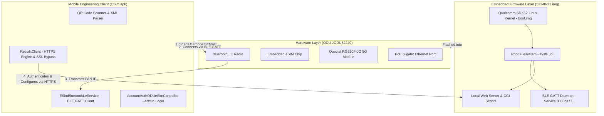
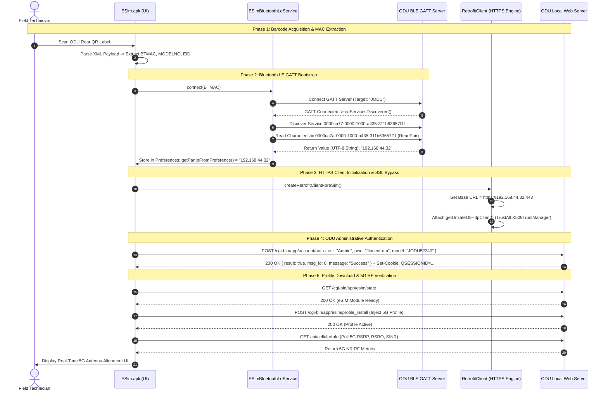

# Comprehensive Technical Study Guide: Jio AirFiber ODU Provisioning, BLE GATT Handshake, and Embedded Network Architecture

**Document Type:** Technical Architecture & Engineering Reference Note  
**Target Systems:** Jio AirFiber Outdoor Unit (ODU), Android Field Provisioning Engine, Firmware FOTA Image  
**Artifacts Analyzed:**
- Mobile App 1: `JioFieldDiagnostics_1.0.20.apks` (`com.jio.test.scanner`)
- Mobile App 2: `ESim.apk` (`com.jio.esim` v1.7.157)
- Firmware Image: `52240-21.img` (Quectel RG520F-JO / Qualcomm Snapdragon SDX62)

---

## 1. Executive Overview & System Ecosystem

The Jio AirFiber deployment architecture consists of a tightly integrated triad: **Physical Hardware (ODU)**, **Embedded Firmware (`52240-21.img`)**, and **Mobile Client Applications (`ESim.apk` / `JioFieldDiagnostics`)**.



### The Physical Installation Context
During field installation:
1. The **Outdoor Unit (ODU)** is mounted externally on a rooftop, mast, or wall to achieve line-of-sight with a Jio 5G NR (New Radio) gNodeB tower.
2. At power-on via the Power-over-Ethernet (PoE) adapter, the ODU does **not** yet have an active internet connection, functional Wi-Fi, or an activated cellular profile.
3. To bootstrap initial configuration without requiring physical laptop cabling, the system employs a **hybrid wireless bootstrap mechanism**:
   - **Bluetooth Low Energy (BLE)** is used as the initial discovery and bootstrap transport.
   - **Local TCP/IP over HTTPS** is used as the high-level configuration and profile provisioning transport.

---

## 2. Comparative Analysis of Mobile Application Artifacts

Our decompilation and static bytecode analysis revealed that the two mobile packages on the host serve distinct, complementary purposes:

| Architectural Dimension | `JioFieldDiagnostics_1.0.20.apks` | `ESim.apk` |
|---|---|---|
| **Package Identifier** | `com.jio.test.scanner` | `com.jio.esim` |
| **Version & Build** | v1.0.20 (VersionCode: 26) | v1.7.157 (VersionCode: 17) |
| **Compiled Binary Size** | ~11 MB | ~37 MB |
| **Architectural Role** | **Lightweight Scanner & Hand-off Stub** | **Full Core Provisioning Engine** |
| **Core Libraries Included** | AndroidX, CameraX, Google ML Kit | `com.jio.esimprovisioning`, RxBluetooth, Retrofit, Room |
| **Bluetooth / BLE Stack** | None (Delegates to external application) | Full custom BLE GATT client (`ESimBluetoothLeService`) |
| **ODU Direct Network Client** | None | Full Retrofit HTTPS client (`EsimProvisioningService`) |
| **Data Flow Target** | Encrypts data via AES-GCM and launches `com.jio.home.jfe` | Directly pairs with ODU, logs in, installs eSIM, monitors RF |

### 2.1 The `JioFieldDiagnostics` Hand-off Mechanism
`JioFieldDiagnostics` operates strictly as a front-end scanner:
1. It uses CameraX and ML Kit (`BarCodeAndQRCodeAnalyser.java`) to scan the ODU's QR label.
2. It parses the XML data payload to extract `BTMAC`, `MODELNO`, and `EID`.
3. In `OpenJioHome.java`, it constructs an internal payload:
   ```json
   {
     "module_name": "ES",
     "work_order_id": "6000013046",
     "eid": "<EID>",
     "iccid": "7869879573676773680",
     "encrypted_token": "8f7c2370-398e-4685-8f00-98335df01cf8",
     "request_url": "https://jpw-sit.jio.com/api/workorder-info/SaveESIMProfileDownloadStatus",
     "modelno": "<MODEL_NO>",
     "btmac": "<BTMAC>",
     "idu_RSN": "<RSN>"
   }
   ```
4. It encrypts this string using `JPWEncryptionUtils.java` (`AES/GCM/NOPADDING` 128-bit) and fires an explicit Android Intent to launch the primary Jio Field Engineer application:
   - Target Component: `com.jio.home.jfe / com.jio.home.jfe.ui.activity.HandleJPWIntentActivity`
   - Intent Extra: `"THIRD_APP_DATA"`

### 2.2 The `ESim.apk` Full Provisioning Engine
`ESim.apk` contains the actual native engineering libraries (`com.jio.esimprovisioning`) responsible for managing the direct hardware interaction with the ODU.

---

## 3. The Complete End-to-End ODU Provisioning Lifecycle



### Detailed Phase Breakdown

#### Phase 1: Physical Barcode Scanning & Payload Decoding
The QR code attached to the ODU casing contains an XML structure formatted as follows:
```xml
<class>
    <SRNO>RSQODGK1K457493</SRNO>
    <MFRNAME>JIO</MFRNAME>
    <MODELNO>JODU52240</MODELNO>
    <EAN>8903302342630</EAN>
    <IMEI>864987050123456</IMEI>
    <EID>89033023426300000000017990833328</EID>
    <BTMAC>A83B76B28E9B</BTMAC>
</class>
```
The parsing logic in `ESimScanQRCodeActivity.java`:
1. Validates that `<SRNO>` contains the substring `"OD"`, verifying it is an Outdoor Unit.
2. Extracts `<BTMAC>` (`A83B76B28E9B`) and converts it to standard IEEE 802 colon-delimited notation: `A8:3B:76:B2:8E:9B`.
3. Passes `mac`, `model`, and `eid` to `BLEConnectActivity.java`.

#### Phase 2: BLE GATT Handshake & Dynamic IP Retrieval
In `ESimBluetoothLeService.java`:
- The phone initiates an active GATT connection using `BluetoothDevice.connectGatt(context, false, mGattCallback)`.
- The target advertisement identity is matched against `STB_NAME = "JODU"`.
- Upon successful service discovery, the service enumerates characteristics under the proprietary Jio ODU Service:
  - **Service UUID:** `0000ca77-0000-1000-a435-311b63657f1f`
  - **Write Characteristic:** `0000ca78-0000-1000-a435-311b63657f1f`
  - **Notify Characteristic:** `0000ca79-0000-1000-a435-311b63657f1f`
  - **Read Pair Characteristic:** `0000ca7a-0000-1000-a435-311b63657f1f`
- The application executes `readCharacteristic(readPairCharacteristic)`.
- When `onCharacteristicRead` triggers:
  ```java
  byte[] value = characteristic.getValue();
  String ipString = new String(value, StandardCharsets.UTF_8);
  JioMesh.getInstance().storePanIpInPreference(ipString);
  ```
  The value returned is the ASCII representation of the ODU's local IP address (typically `192.168.44.32`).

#### Phase 3: Administrative Authentication via Local REST API
Once the IP is stored, `BLEConnectActivity.java` invokes `checkForPanIPAndLogin()`:
```java
void checkForPanIPAndLogin() {
    String panIp = JioMesh.getInstance().getPanIpFromPreference();
    if (panIp != null && !panIp.isEmpty()) {
        eSimLogin("Admin", "Jiocentrum");
    }
}
```
In `AccountAuthODUeSimController.java`:
- Endpoint: `POST https://<pan_ip>/cgi-bin/app/account/auth`
- Request Headers: `Content-Type: application/json`
- Request Body:
  ```json
  {
    "usr": "Admin",
    "pwd": "Jiocentrum",
    "model": "JODU52240"
  }
  ```
- Response from ODU:
  ```json
  {
    "result": true,
    "msg_id": 0,
    "message": "Success"
  }
  ```
- The response sets session cookies (`Cookie: QSESSIONID=...`), which `TokenAuthorizationInterceptor` injects into subsequent requests.

#### Phase 4: Operational eSIM & RF APIs (`EsimProvisioningService.java`)
With an authenticated session established, the app utilizes the complete suite of CGI endpoints:
- `GET /cgi-bin/app/esim/state`: Verifies physical eSIM chip status.
- `POST /cgi-bin/app/esim/profile_install`: Instructs the ODU's embedded Local Profile Assistant (LPA) to download and activate the operational 5G profile.
- `GET api/cellularInfo`: Queries modem telemetry (5G NR band, physical cell ID, RSRP, RSRQ, SINR) for live antenna alignment.

---

## 4. Networking & Embedded SSL/TLS Engineering

### 4.1 The Embedded Device HTTPS Dilemma
When an application connects to a public domain like `https://jio.com`, the server presents an X.509 certificate signed by a recognized Certificate Authority (CA) such as DigiCert or Google Trust Services.

However, an embedded hardware device like an ODU operating on a local private subnet (`192.168.44.32` or `192.168.225.1`) cannot obtain a public CA-signed certificate because:
1. Public CAs cannot issue certificates for private RFC 1918 IP addresses.
2. The device functions autonomously in environments without prior internet access.
3. Consequently, the ODU generates an internal **Self-Signed SSL Certificate**.

Under standard Android security behavior, any HTTPS request to a self-signed endpoint immediately halts with:
- `javax.net.ssl.SSLHandshakeException: Trust anchor for certification path not found`
- `javax.net.ssl.SSLPeerUnverifiedException: Hostname not verified`

### 4.2 The `getUnsafeOkHttpClient()` Bypass Implementation
In [`RetrofitClient.java`](file:///home/dc/Downloads/J%20Filed/esim_jadx_out/sources/com/jio/esimprovisioning/model/transport/RetrofitClient.java#L100-L135), the engineering team resolved this by implementing an explicit trust-all SSL client factory:

```java
private static OkHttpClient.Builder getUnsafeOkHttpClient(Long timeout) {
    try {
        // 1. Create a TrustManager that accepts all certificates unconditionally
        TrustManager[] trustManagerArr = {new X509TrustManager() {
            @Override
            public void checkClientTrusted(X509Certificate[] chain, String authType) {
                // No validation performed
            }

            @Override
            public void checkServerTrusted(X509Certificate[] chain, String authType) {
                // Empty implementation: no exception thrown means certificate is accepted
            }

            @Override
            public X509Certificate[] getAcceptedIssuers() {
                return new X509Certificate[0];
            }
        }};

        // 2. Initialize SSLContext with the permissive TrustManager
        SSLContext sslContext = SSLContext.getInstance("SSL");
        sslContext.init(null, trustManagerArr, new SecureRandom());

        // 3. Configure OkHttpClient Builder
        OkHttpClient.Builder builder = new OkHttpClient.Builder();
        builder.sslSocketFactory(sslContext.getSocketFactory(), (X509TrustManager) trustManagerArr[0]);

        // 4. Override Hostname Verification to always return true
        builder.hostnameVerifier(new HostnameVerifier() {
            @Override
            public boolean verify(String hostname, SSLSession session) {
                return true; // Bypasses hostname / IP mismatch checks
            }
        });

        // 5. Attach Session Interceptor & Connection Specs
        builder.addInterceptor(new TokenAuthorizationInterceptor());
        builder.connectionSpecs(Arrays.asList(connectionSpecBuild, ConnectionSpec.CLEARTEXT));
        builder.connectTimeout(timeout.longValue(), TimeUnit.SECONDS);

        return builder;
    } catch (Exception e) {
        throw new RuntimeException(e);
    }
}
```

### 4.3 Engineering Trade-Offs & Security Considerations

| Approach | Security Level | Maintenance Overhead | Suitability for ODU Provisioning |
|---|---|---|---|
| **Trust-All (`getUnsafeOkHttpClient`)** *(Current)* | **Low (Vulnerable to MITM)** | **Zero** (Works with any hardware vendor) | Pragmatic for closed, direct point-to-point BLE sessions; unsafe on public networks. |
| **Certificate / Key Pinning** | **High** | **High** (App must be updated if device cert rotates) | Difficult across multi-vendor manufacturing lines. |
| **Custom Private Root CA** | **High** | **Medium** (Private CA cert bundled in app resources) | Recommended enterprise architecture for production IoT fleets. |
| **Android Network Security Config** | **Standard** | **Low** (Declarative XML configuration) | Supported on Android 7.0+ (`res/xml/network_security_config.xml`). |

---

## 5. Firmware Image Analysis (`52240-21.img`)

Our inspection of `/home/dc/Downloads/52240-21.img` confirmed that it is a **Quectel FOTA Update Package** compiled specifically for the ODU:

### 5.1 Firmware Metadata & Hardware Mapping
- **Archive Format:** Deflate Zip Archive (119 MB uncompressed to 131.7 MB).
- **Project Target:** `RG520FJO` (`Quectel RG520F-JO`).
- **SoC Architecture:** Qualcomm Snapdragon SDX62 ("sdxlemur") 5G Modem-RF System.
- **Model Correlate:** Matches `JODU52240` referenced throughout the mobile application decompilation.

### 5.2 Archive Structure & Partitions
```
52240-21.img
├── project-name                      [Target: RG520FJO]
├── quectel_arb_versions.txt          [Anti-Rollback version definitions]
├── quectel_signing_check.txt         [Cryptographic partition verification manifests]
├── MULTIFOTA/
│   └── multifota.bin                 [Multi-partition flash bootstrapper]
├── full-images/
│   ├── sdxlemur-boot.img             [Linux kernel + initramfs for SDX62 AP]
│   ├── sdxlemur-sysfs.ubi            [UBIFS Root Filesystem: web server, daemons, scripts]
│   └── NON-HLOS.ubi                  [Qualcomm Hexagon DSP Modem baseband firmware]
└── META-INF/com/google/android/
    ├── update-binary                 [Quectel FOTA installer executable]
    └── updater-script                [Flash orchestration script]
```

### 5.3 Execution Mechanism on Hardware
1. When flashed or executed during recovery, `updater-script` installs `sdxlemur-boot.img` to the NAND boot partition and `sdxlemur-sysfs.ubi` to the system partition.
2. The root filesystem contains:
   - The lightweight web server listening on port 8080 (HTTP) and port 443 (HTTPS).
   - The CGI binaries located in `/cgi-bin/app/` that implement `account/auth` and `esim/profile_install`.
   - The BlueZ / Qualcomm Bluetooth stack that hosts the `0000ca77...` GATT server.

---

## 6. Alternative Developer & Engineering Access Interfaces

In addition to the mobile app workflow, hardware engineers and network operators have multiple direct interfaces to access the ODU:

### 6.1 Direct PoE Ethernet Cable Connection
- **Physical Link:** Connect an Ethernet patch cable from the PoE Injector's **"LAN"** port to a laptop.
- **Network Configuration:** Set laptop IPv4 statically to `192.168.225.50` (Subnet: `255.255.255.0`, Gateway: `192.168.225.1`).
- **Direct Web Consoles:**
  - `http://192.168.225.1:8080` (Direct HTTP Management)
  - `http://192.168.225.1/jiooscc/` (Jio OS CPE Controller)
  - `http://jioodu.local.html:8080` (Local mDNS/NetBIOS Alias)
- **Authentication:** Username: `Admin`, Password: `Jiocentrum`.

### 6.2 Indoor Unit (IDU) Wi-Fi Mesh Gateway Link
When connected to the internal Jio Wi-Fi 6 router (IDU), the ODU is routed transparently on the home network, enabling diagnostic access via `http://jiofiber.local.html`.

### 6.3 Remote Cloud TR-069 / CWMP ACS Management
Once the 5G data bearer is active, the ODU connects upstream to Jio's central Auto Configuration Server (ACS) via TR-069 / TR-181 protocols, enabling remote firmware upgrades, telemetry collection, and parameter configuration from the Network Operations Center (NOC).

### 6.4 Hardware UART Serial Console (PCB Level)
For low-level board bring-up and firmware debugging:
- The internal ODU PCB features dedicated UART pads (TX, RX, GND, 3.3V).
- Connecting a USB-to-TTL serial adapter at 115200 baud provides direct access to the Qualcomm U-Boot bootloader and an interactive BusyBox root shell (`/bin/sh`).

---

## 7. Summary & Study Reference Table

| Layer | Component | Implementation Detail | Source Reference |
|---|---|---|---|
| **Front-end Scanning** | `JioFieldDiagnostics` | ML Kit QR scanning, XML parsing, AES-GCM hand-off | `ESimScanQRCodeActivity.java`, `OpenJioHome.java` |
| **Discovery Transport** | BLE GATT Service | UUID `0000ca77...`, Char `0000ca7a...` returns IP string | `ESimBluetoothLeService.java:98` |
| **Network Transport** | Local HTTPS / Retrofit | `https://192.168.44.32:443`, `getUnsafeOkHttpClient` | `RetrofitClient.java:100` |
| **Local Auth API** | CGI REST Handler | `POST /cgi-bin/app/account/auth` (`Admin` / `Jiocentrum`) | `AccountAuthODUeSimController.java:21` |
| **Operating System** | Embedded Linux FOTA | SDX62 "sdxlemur", Quectel RG520F-JO | `52240-21.img` / `updater-script` |
| **Direct Management** | Local PoE Ethernet | `http://192.168.225.1:8080`, `http://192.168.225.1/jiooscc/` | `BuildConfig.java:17` |

---
*Report generated for technical study and architectural understanding. Artifacts preserved in their original state.*
